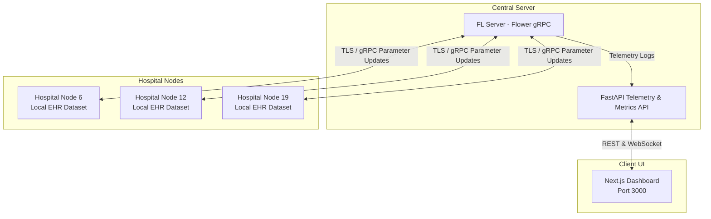

# Centralized Federated Learning for Hospital Management System

A privacy-preserving, centralized Federated Learning (FL) framework designed for healthcare systems and hospital networks. It trains collaborative predictive models across decentralized hospital nodes without exposing patient-level raw electronic health records (EHR).

---

## 🌟 Key Features

- **Privacy-Preserving Architecture**: Raw clinical and patient data never leaves individual hospital environments. Only model parameter updates and federated metrics are transmitted over secure TLS gRPC channels.
- **Federated Optimization (FedAvg / FedProx)**: Supports standard Federated Averaging as well as FedProx with proximal regularization ($\mu$) to handle statistical heterogeneity across diverse hospital datasets.
- **Differential Privacy & Security**: Integrated with self-signed or CA-managed TLS encryption and DP mechanisms (Opacus) to prevent weight reconstruction attacks.
- **Real-Time Monitoring & Metrics**: FastAPI service exposing REST and WebSocket endpoints for live telemetry, convergence stats, accuracy/loss curves, and node participation.
- **Interactive Next.js Dashboard**: Modern frontend displaying hospital nodes, round-by-round federated training metrics, and privacy budgets.
- **Full Orchestration**: Run locally with a single PowerShell script (`start_all.ps1`) or via multi-container Docker Compose.

---

## 🏗️ System Architecture



---

## 📁 Repository Structure

```
├── backend/
│   ├── api/                  # FastAPI metrics & telemetry service
│   ├── certs/                # Local development TLS certificates (ignored)
│   ├── client/               # Hospital node client implementation (Flower client)
│   ├── data_pipeline/        # EHR data ingestion, preprocessing, and loaders
│   ├── server/               # FL central server & aggregation strategies (FedProx)
│   ├── shared/               # Shared model architectures and protocol definitions
│   ├── tests/                # Test suite for unit and simulation tests
│   ├── generate_dev_cert.py  # Self-signed TLS certificate generation script
│   ├── generate_mock_data.py # Synthetic hospital EHR generator for testing
│   ├── requirements.txt      # Python dependencies
│   └── Dockerfile            # Backend container configuration
├── frontend/
│   ├── app/                  # Next.js App Router pages
│   ├── components/           # UI components, charts, and metrics cards
│   ├── lib/                  # API clients and utilities
│   ├── package.json          # Frontend dependencies
│   └── ...
├── DATA/                     # Local benchmark / mock datasets
├── docker-compose.yml        # Multi-node local deployment orchestrator
└── start_all.ps1             # Windows PowerShell one-click runner
```

---

## 🚀 Quick Start

### 1. Prerequisites

- **Python**: 3.10+
- **Node.js**: 18+ and `npm`
- **Docker & Docker Compose** (optional, for containerized run)

### 2. Setup Certificates & Backend

```bash
cd backend
python -m venv venv

# Windows
.\venv\Scripts\activate
# Linux/macOS
source venv/bin/activate

pip install -r requirements.txt

# Generate self-signed TLS certificates for local simulation
python generate_dev_cert.py
```

### 3. Setup Frontend

```bash
cd ../frontend
npm install
cp .env.example .env.local
```

### 4. Run the Network

#### Option A: One-Click PowerShell (Windows)
Run from the root directory:
```powershell
.\start_all.ps1
```

#### Option B: Docker Compose
```bash
# Generate dev certs first if not already present
python backend/generate_dev_cert.py

# Launch all nodes and server
docker compose up --build
```

#### Option C: Manual Launch
1. **Central Server**:
   ```bash
   python backend/server/fl_server.py --rounds 3 --min_clients 3 --proximal_mu 0.1
   ```
2. **Hospital Nodes** (run each in a separate terminal):
   ```bash
   python backend/client/hospital_node.py --hospitalid 6 --server_address localhost:8443
   python backend/client/hospital_node.py --hospitalid 12 --server_address localhost:8443
   python backend/client/hospital_node.py --hospitalid 19 --server_address localhost:8443
   ```
3. **Telemetry API**:
   ```bash
   cd backend/api
   uvicorn main:app --host 0.0.0.0 --port 8000
   ```
4. **Dashboard**:
   ```bash
   cd frontend
   npm run dev
   ```

Visit `http://localhost:3000` to view the live dashboard.

---

## 🔒 Security & Compliance

- **EHR Privacy**: Raw patient records in `DATA/` are only read by client containers or local hospital nodes and are never transmitted over network boundaries.
- **Encrypted Channels**: Local nodes communicate with the central server via TLS-encrypted gRPC channels using certificates generated via `backend/generate_dev_cert.py`.
- **Differential Privacy**: Hospital updates can incorporate Gaussian noise and gradient clipping via Opacus to meet differential privacy ($\epsilon, \delta$) guarantees.

---

## 📄 License

This project is licensed under the MIT License.
